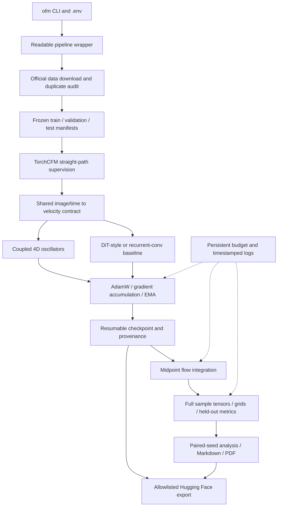

# Oscillatory flow matching

Train an unconditional image generator whose velocity network uses coupled Kuramoto oscillators. The network predicts how to move Gaussian noise toward MNIST or CIFAR-10 images; TorchCFM supplies the straight conditional flow-matching target and torchdiffeq integrates the learned velocity. The oscillator model uses no attention. A small DiT-style transformer and recurrent convolutional control share the training pipeline and approximately matched parameter counts.

The study asks about **sample quality versus measured computational cost**. Superior oscillator performance is an empirical question. The [pre-specified protocol](docs/protocol.md) defines the six paired CIFAR seeds, fixed 45-minute runs, primary KID analysis, controls, power calculation, and cumulative 24 GPU-hour cap. [Experiment reports](reports/) distinguish completed evidence from pending work; a working implementation alone does not establish comparative quality.

## Install and run

Use Linux or WSL, Python 3.12, and [uv](https://docs.astral.sh/uv/getting-started/installation/). The project uses a local `.venv`. CUDA installation is pinned to PyTorch 2.11.0 / torchvision 0.26.0 CUDA 12.8 wheels, verified on the local RTX 5070 Laptop GPU. A compatible NVIDIA driver and approximately 8 GB VRAM are the target; the CPU variant also runs sampling and software tests.

```bash
git clone https://github.com/BurnyCoder/flow-matching-with-oscillatory-neural-networks-instead-of-transformer.git
cd flow-matching-with-oscillatory-neural-networks-instead-of-transformer
uv sync --frozen --extra cuda
# For a CPU-only installation, use instead: uv sync --frozen --extra cpu
cp .env.example .env
uv run --no-sync ofm --help
```

The first training command downloads the selected official dataset, reserves validation examples, audits exact pixel duplicates, freezes split manifests, and then trains. Expect several GB of dependency downloads and additional disk space for datasets, checkpoints, full generated tensors, and releases. `uv run --no-sync` preserves the accelerator environment selected above.

```bash
# Short execution check; this is too brief to establish image quality.
uv run --no-sync ofm train --dataset mnist --model onn --run-dir runs/example --steps 50 --minutes 3
uv run --no-sync ofm train --resume runs/example --steps 100
uv run --no-sync ofm sample --run runs/example --count 64 --nfe 32
uv run --no-sync ofm sample --run runs/example --device cpu --count 16
uv run --no-sync ofm evaluate --run runs/example --split validation --count 128
uv run --no-sync ofm report --root runs/example --output reports/example
```

Set `OFM_DEVICE=cpu` in `.env` or pass `--device cpu` for new CPU runs. Resume restores the saved device and all scientific settings; only explicitly supplied `--minutes` and `--steps` change stopping limits. Do not reuse development run directories for the final study. A useful MNIST training run is longer than this smoke check; the pilot schedule gives each architecture 20 minutes.

`ofm train --config path/to/config.json --run-dir runs/new-run` starts from a complete saved configuration. This form uses the file's settings instead of other CLI/environment defaults. The study runner uses it to inherit actual frozen pilot settings for CIFAR runs.

## Reproduce the study

```bash
uv run --no-sync ofm study --dry-run
uv run --no-sync ofm study --phase checks
uv run --no-sync ofm study --phase pilot
uv run --no-sync ofm study --phase main
uv run --no-sync ofm study --phase ablations
uv run --no-sync ofm study --phase evaluate
uv run --no-sync ofm report --root runs/study --output reports
# Equivalent sequential orchestration from a fresh study: ofm study --phase all
```

Completed arms and evaluations are reused; incomplete training resumes from its latest complete optimizer checkpoint. A failed command stops the schedule and preserves its artifacts for diagnosis. Pilot completion writes the freeze record before CIFAR training. `--split test` is explicit for standalone evaluation; the study runner uses it only after the freeze. Never tune against those results.

All CUDA commands share `runs/budget.json` by default. It reserves time before GPU work, refunds unused time on a clean exit, and conservatively retains reservations after crashes. A separate process enforces each deadline. **Do not delete the ledger or change `OFM_RUNS_ROOT` to restart the study's budget.** Keep the same `.env` when resuming. The 24-hour allocation includes development and evaluation; software waits/downloads inside a reservation are conservatively charged. CPU-only commands do not spend GPU allocation. Only one GPU command may hold the reservation at a time.

## Model and data flow



The oscillator backbone has four width-128 blocks, 4×4 patches, four-dimensional unit-vector states, learned 3×3 coupling, skew-symmetric natural frequencies, continuous time conditioning, and mixed-state norm readouts. Four internal updates of size 0.1 occur inside each velocity call. The outer sampler initially uses 16 midpoint steps, **32 velocity evaluations**. The two time axes are separate. Every forward call starts from a deterministic learned state and preserves image shape.

The default CIFAR models have 1,297,712 oscillator, 1,298,864 transformer, and 1,296,688 recurrent-control parameters. The transformer feed-forward width resolves to 576. Trained no-coupling and no-frequency ablations remove their named terms; their changed parameter counts are reported, not concealed. Implementation details and artifact contracts are in [docs/implementation.md](docs/implementation.md).

## Features and technologies

- Training from scratch, EMA inference, exact optimizer-boundary resumption, explicit independent RNG streams, and paired data/noise prefixes.
- Duplicate-audited official splits, dataset/checkpoint hashes, resolved configurations, dependency versions, Git revision history, and preserved failures.
- BF16 CUDA training with float32 oscillator geometry, float32/CPU sampling, synchronized latency and peak allocated GPU memory measurements.
- CIFAR KID/FID through torch-fidelity; MNIST pixel-space sliced Wasserstein diagnostics through POT; SciPy paired inference and a reproducible NumPy planning-power simulation.
- Preselected sample grids, complete unclipped tensors in safetensors, timestamped structured logs and complete command transcripts; no runtime LLM service.
- Markdown experiment records, a consolidated comparison/glossary, scientific figures through Matplotlib, and PDFs through bundled Pandoc and Typst.
- Explicit Hugging Face exports with model cards, original checkpoints, safe inference weights, and SHA-256 manifests.

Core libraries are Python, PyTorch, torchvision, TorchCFM, torchdiffeq, torch-fidelity, NumPy, SciPy, POT, safetensors, python-dotenv, huggingface-hub, Matplotlib, Pandoc, and Typst. `uv.lock` records exact resolved versions. Sources for the model equations and statistical decisions are linked in the protocol and code comments. This original implementation does not copy unlicensed AKOrN source code.

## Artifacts and publication

`runs/<run>/` contains `config.json`, `data_manifest.json`, `environment.json`, `checkpoint.pt`, `training.json`, and `run.log`. Sampling/evaluation directories add raw `samples.safetensors`, `grid.png`, and complete metric/timing JSON. `runs/commands/` captures full emitted stdout/stderr. Large arrays stay in tensor artifacts instead of abbreviated text dumps. `reports/` contains generated evidence, including each experiment's Markdown/PDF and the technical paper. Failed and incomplete runs remain distinguishable from completed final-budget results.

```bash
# Prepare real exports without authentication or network writes.
uv run --no-sync ofm publish --root runs --dry-run
# Authenticate within the workspace-local HF_HOME configured in .env.
HF_HOME=.cache/huggingface uv run --no-sync hf auth login
# Explicitly upload all reported checkpoints and group them in one public collection.
uv run --no-sync ofm publish --root runs --namespace BurnyCoder
```

Publication requires a Hub token authorized to create/write the selected account's model repositories and collection. Keep tokens in the local authentication store or an untracked `HF_TOKEN` environment setting; never put them in commands, Git, model cards, or logs. Dataset-specific repositories contain one directory per run, each loadable with `ofm sample --run /path/to/downloaded/run`. No LLM API key is required. Source data, `.venv`, `.env`, caches, raw runs, and export staging are excluded from Git.

The public [Hugging Face collection](https://huggingface.co/collections/BurnyCoder/oscillatory-flow-matching-local-exploratory-study-6ad2aa5b3f5a7563a8018be2) groups released artifacts. Check each model card's role and status: a development or fixed-batch checkpoint is not a completed final-study generator.

## Verification and contribution

```bash
uv run --no-sync pytest -q
uv run --no-sync ruff check src tests
```

Tests cover flow targets, tangent projection, normalization, finite gradients, stateless deterministic predictions, model shapes, parameter matching, sampler direction/NFE, exact CPU resume, persistent budget enforcement, metric preprocessing, paired inference, incomplete-report behavior, and safe export/reload. The real workflow additionally checks GPU execution, fixed-batch overfitting, CPU sampling, visual outputs, and PDF generation. Contributor rules are in [AGENTS.md](AGENTS.md); scientific outcomes belong in the reports, including negative and inconclusive results.
