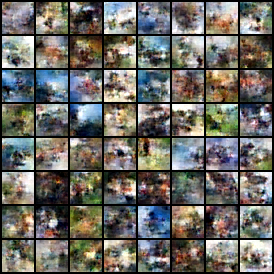

# Control: study/main/cifar10-onn-s101/cpu-public-check

## Purpose and interpretation

This diagnostic checks the contract recorded below, such as checkpoint reconstruction, metric repetition, or identity-intervention behavior. It is excluded from primary paired-seed inference and cannot establish an oscillator mechanism by itself.

## Recorded evidence

```json
{
  "publication": "exports/20261017T191733.840771Z/publication.json",
  "hub_revisions": {
    "BurnyCoder/oscillatory-flow-matching-cifar10": "533f6fc215dcc8e9fbb2c841bc5441edf321ff7b",
    "BurnyCoder/oscillatory-flow-matching-mnist": "0dde0d9743dd9d08c9e5f0f11a142bcb9bd5eb02"
  },
  "published_checkpoint_count": 31,
  "all_remote_weight_hashes_match": true,
  "remote_weight_checks": [
    {
      "repository": "BurnyCoder/oscillatory-flow-matching-cifar10",
      "revision": "533f6fc215dcc8e9fbb2c841bc5441edf321ff7b",
      "path": "checks/cifar10-metric-smoke/model.safetensors",
      "sha256": "c6ef33c9235e17feb0c2656fcc29364fa02d5dd9dabf27b05c314c01420090d9"
    },
    {
      "repository": "BurnyCoder/oscillatory-flow-matching-cifar10",
      "revision": "533f6fc215dcc8e9fbb2c841bc5441edf321ff7b",
      "path": "study/ablations/cifar10-no_coupling-s101/model.safetensors",
      "sha256": "90e80072c9a90978f8f2a30d80412ba0fb7976a049d69dd09c97210c746a5313"
    },
    {
      "repository": "BurnyCoder/oscillatory-flow-matching-cifar10",
      "revision": "533f6fc215dcc8e9fbb2c841bc5441edf321ff7b",
      "path": "study/ablations/cifar10-no_coupling-s102/model.safetensors",
      "sha256": "7b4006f783489f1f3eb11be8f7441aa92b5df640cf7a775ad5498422fb2ac54d"
    },
    {
      "repository": "BurnyCoder/oscillatory-flow-matching-cifar10",
      "revision": "533f6fc215dcc8e9fbb2c841bc5441edf321ff7b",
      "path": "study/ablations/cifar10-no_frequency-s101/model.safetensors",
      "sha256": "e414bd1148c47d7eb29817e4d725bdbffb03b37df5abbbc41e78924c149ca58a"
    },
    {
      "repository": "BurnyCoder/oscillatory-flow-matching-cifar10",
      "revision": "533f6fc215dcc8e9fbb2c841bc5441edf321ff7b",
      "path": "study/ablations/cifar10-no_frequency-s102/model.safetensors",
      "sha256": "395b21f842524dfe11c55360d2093be3d562406a87a0f3af51b154887f33285a"
    },
    {
      "repository": "BurnyCoder/oscillatory-flow-matching-cifar10",
      "revision": "533f6fc215dcc8e9fbb2c841bc5441edf321ff7b",
      "path": "study/controls/untrained-conv/model.safetensors",
      "sha256": "a09c911b1517c717c7527fa511e42da3abe44ad546b1ac8c47726cf2dc96af82"
    },
    {
      "repository": "BurnyCoder/oscillatory-flow-matching-cifar10",
      "revision": "533f6fc215dcc8e9fbb2c841bc5441edf321ff7b",
      "path": "study/controls/untrained-dit/model.safetensors",
      "sha256": "e0e8e1d0ed79b23b982ae432972278986797979ab46c66c70acb115217b00c18"
    },
    {
      "repository": "BurnyCoder/oscillatory-flow-matching-cifar10",
      "revision": "533f6fc215dcc8e9fbb2c841bc5441edf321ff7b",
      "path": "study/controls/untrained-onn/model.safetensors",
      "sha256": "c6ef33c9235e17feb0c2656fcc29364fa02d5dd9dabf27b05c314c01420090d9"
    },
    {
      "repository": "BurnyCoder/oscillatory-flow-matching-cifar10",
      "revision": "533f6fc215dcc8e9fbb2c841bc5441edf321ff7b",
      "path": "study/main/cifar10-conv-s101/model.safetensors",
      "sha256": "d20f3947bcf79794427f8215c597a57c4b5eef3b308ccaccf1960beb86b4188e"
    },
    {
      "repository": "BurnyCoder/oscillatory-flow-matching-cifar10",
      "revision": "533f6fc215dcc8e9fbb2c841bc5441edf321ff7b",
      "path": "study/main/cifar10-conv-s102/model.safetensors",
      "sha256": "7c81f89410f40e356ad05be8cb60016c65181208541c303d8ba1665778d1ce3c"
    },
    {
      "repository": "BurnyCoder/oscillatory-flow-matching-cifar10",
      "revision": "533f6fc215dcc8e9fbb2c841bc5441edf321ff7b",
      "path": "study/main/cifar10-conv-s103/model.safetensors",
      "sha256": "66eb47d34559e0a1127012efc6888a22546eb0b9e9b94e7e28821dbd6c404441"
    },
    {
      "repository": "BurnyCoder/oscillatory-flow-matching-cifar10",
      "revision": "533f6fc215dcc8e9fbb2c841bc5441edf321ff7b",
      "path": "study/main/cifar10-conv-s104/model.safetensors",
      "sha256": "c896d46723b1f6e52eb8b6ad1e8fbdfc9c889784b5e114fe73606f538ed3d1ac"
    },
    {
      "repository": "BurnyCoder/oscillatory-flow-matching-cifar10",
      "revision": "533f6fc215dcc8e9fbb2c841bc5441edf321ff7b",
      "path": "study/main/cifar10-conv-s105/model.safetensors",
      "sha256": "d872edbf5e8bf7c11f03b6637adfc2762a009a6b0ea659f48e595e4d853cd5b7"
    },
    {
      "repository": "BurnyCoder/oscillatory-flow-matching-cifar10",
      "revision": "533f6fc215dcc8e9fbb2c841bc5441edf321ff7b",
      "path": "study/main/cifar10-conv-s106/model.safetensors",
      "sha256": "2057aaaf7d16b4220dfdc8bc9d8ef32a6e91388223e30e65c2d72252f4562cd4"
    },
    {
      "repository": "BurnyCoder/oscillatory-flow-matching-cifar10",
      "revision": "533f6fc215dcc8e9fbb2c841bc5441edf321ff7b",
      "path": "study/main/cifar10-dit-s101/model.safetensors",
      "sha256": "cc227d4e18a7e1d94a2a9e0d34e809f86a8798e0c8e283af84968e529a1c8a67"
    },
    {
      "repository": "BurnyCoder/oscillatory-flow-matching-cifar10",
      "revision": "533f6fc215dcc8e9fbb2c841bc5441edf321ff7b",
      "path": "study/main/cifar10-dit-s102/model.safetensors",
      "sha256": "2e584a96062f1a454dce28bb6322e17731df8999e32045b8ed7f9fe8fb4453cc"
    },
    {
      "repository": "BurnyCoder/oscillatory-flow-matching-cifar10",
      "revision": "533f6fc215dcc8e9fbb2c841bc5441edf321ff7b",
      "path": "study/main/cifar10-dit-s103/model.safetensors",
      "sha256": "75bca1cf3738374c420f34e36b0679e6369cf3fa86343aa762f0ff85bd6df64b"
    },
    {
      "repository": "BurnyCoder/oscillatory-flow-matching-cifar10",
      "revision": "533f6fc215dcc8e9fbb2c841bc5441edf321ff7b",
      "path": "study/main/cifar10-dit-s104/model.safetensors",
      "sha256": "3aba95b3af00dd2cad93f206c5af6d73f07431b491ed2e358a2feb8c8a1991c1"
    },
    {
      "repository": "BurnyCoder/oscillatory-flow-matching-cifar10",
      "revision": "533f6fc215dcc8e9fbb2c841bc5441edf321ff7b",
      "path": "study/main/cifar10-dit-s105/model.safetensors",
      "sha256": "38b99f5c030c04a12c83c9b41ee55c16a4cde20c557e29b274950dbeb6d4a292"
    },
    {
      "repository": "BurnyCoder/oscillatory-flow-matching-cifar10",
      "revision": "533f6fc215dcc8e9fbb2c841bc5441edf321ff7b",
      "path": "study/main/cifar10-dit-s106/model.safetensors",
      "sha256": "f4b8c7eddf76c637e828ccb902517b2f2efbfb2e269986f81bd5ac965e541f3e"
    },
    {
      "repository": "BurnyCoder/oscillatory-flow-matching-cifar10",
      "revision": "533f6fc215dcc8e9fbb2c841bc5441edf321ff7b",
      "path": "study/main/cifar10-onn-s101/model.safetensors",
      "sha256": "bb7094d51557bb6d7ccfdbaebd393c3cc33bbfcb48963aba33e58c48af187f99"
    },
    {
      "repository": "BurnyCoder/oscillatory-flow-matching-cifar10",
      "revision": "533f6fc215dcc8e9fbb2c841bc5441edf321ff7b",
      "path": "study/main/cifar10-onn-s102/model.safetensors",
      "sha256": "06a34f3c2e2dae9947112142592c6747376ba44959be8efb0ba37bc3687276cd"
    },
    {
      "repository": "BurnyCoder/oscillatory-flow-matching-cifar10",
      "revision": "533f6fc215dcc8e9fbb2c841bc5441edf321ff7b",
      "path": "study/main/cifar10-onn-s103/model.safetensors",
      "sha256": "93b25b900dff3df0f60701b0456a0b45c89eba9e2da7f539f2c290f575f5e4e7"
    },
    {
      "repository": "BurnyCoder/oscillatory-flow-matching-cifar10",
      "revision": "533f6fc215dcc8e9fbb2c841bc5441edf321ff7b",
      "path": "study/main/cifar10-onn-s104/model.safetensors",
      "sha256": "b306ed41c2b415cf5be073c0bbf0c4fcd4fdfee714ac4eab05aff3061021f620"
    },
    {
      "repository": "BurnyCoder/oscillatory-flow-matching-cifar10",
      "revision": "533f6fc215dcc8e9fbb2c841bc5441edf321ff7b",
      "path": "study/main/cifar10-onn-s105/model.safetensors",
      "sha256": "12d9c6bfed79fd4a812af0b18f053486c5852171826f6e0eb453c4868fa3bd00"
    },
    {
      "repository": "BurnyCoder/oscillatory-flow-matching-cifar10",
      "revision": "533f6fc215dcc8e9fbb2c841bc5441edf321ff7b",
      "path": "study/main/cifar10-onn-s106/model.safetensors",
      "sha256": "c8b04e345990d920092c9b209471de71092020c363ac4004d631fddb476b3984"
    },
    {
      "repository": "BurnyCoder/oscillatory-flow-matching-mnist",
      "revision": "0dde0d9743dd9d08c9e5f0f11a142bcb9bd5eb02",
      "path": "checks/mnist-smoke/model.safetensors",
      "sha256": "89560b05f7e7318c1e71d7f8436e6458e469d07b9544ab602c756368d1482404"
    },
    {
      "repository": "BurnyCoder/oscillatory-flow-matching-mnist",
      "revision": "0dde0d9743dd9d08c9e5f0f11a142bcb9bd5eb02",
      "path": "study/checks/fixed-batch/model.safetensors",
      "sha256": "dbc1290adf03cf30958883e06410e5867c99f943e25bdd637684610e552a369f"
    },
    {
      "repository": "BurnyCoder/oscillatory-flow-matching-mnist",
      "revision": "0dde0d9743dd9d08c9e5f0f11a142bcb9bd5eb02",
      "path": "study/pilot/mnist-conv-s101/model.safetensors",
      "sha256": "bffd1bfd5e174490442d518b745e2f1da3416b0e2594b714f47a5dd9f16c1e31"
    },
    {
      "repository": "BurnyCoder/oscillatory-flow-matching-mnist",
      "revision": "0dde0d9743dd9d08c9e5f0f11a142bcb9bd5eb02",
      "path": "study/pilot/mnist-dit-s101/model.safetensors",
      "sha256": "a72223e84aa002fcb68459de860540f70499c1964584c2b1b37b437d2e327366"
    },
    {
      "repository": "BurnyCoder/oscillatory-flow-matching-mnist",
      "revision": "0dde0d9743dd9d08c9e5f0f11a142bcb9bd5eb02",
      "path": "study/pilot/mnist-onn-s101/model.safetensors",
      "sha256": "06201135c2255dcc8b2ee988f9ce128ce6fe2e6eb35f3fd142b3a4db415fec96"
    }
  ],
  "status": "completed",
  "kind": "public-checkpoint-reload",
  "repository": "BurnyCoder/oscillatory-flow-matching-cifar10",
  "run_path": "study/main/cifar10-onn-s101",
  "checkpoint_sha256": "e3eb0aabeaf1f372fbcb2f23bf94625b9fd2a1424504818a02b5d37a4522d6b1",
  "public_weights_sha256": "bb7094d51557bb6d7ccfdbaebd393c3cc33bbfcb48963aba33e58c48af187f99",
  "all_state_tensors_equal": true,
  "prediction_max_absolute_difference": 0.0,
  "device": "cpu",
  "seed": 20261016,
  "sample_count": 64,
  "nfe": 32,
  "sampling": {
    "count": 64,
    "seed": 20261016,
    "nfe": 32,
    "batch_size": 32,
    "seconds": 12.343352994997986,
    "seconds_per_image": 0.19286489054684353,
    "precision": "float32",
    "timing_excludes": "model load and warmup",
    "clipped_fraction": 0.013941447250545025,
    "peak_memory_bytes": null
  },
  "tensor_artifact_sha256": "242680f44618d4508dfea666d40337ed4d084f261d90fcc1d4edcc0c5c7a38df",
  "id": "study/main/cifar10-onn-s101/cpu-public-check",
  "artifact": "runs/study/main/cifar10-onn-s101/cpu-public-check/control.json"
}
```

## Fixed sample grid



## Method choices and learning

The shared optimizer, data policy, architecture, and stopping rule were chosen before final comparison and are described in the technical paper. The 3e-4 learning rate is a conservative AdamW starting point, not a tuned optimum. Microbatches bound laptop memory; four internal updates bound recurrent cost; EMA smooths noisy parameter updates. These choices trade study breadth for a fixed local compute budget. This record supports only the measurements above; causes of quality differences require the trained controls and uncertainty analysis. Full trajectories, populations, RNG states, and logs remain in the referenced artifact bundle. Sources: [protocol](https://github.com/BurnyCoder/flow-matching-with-oscillatory-neural-networks-instead-of-transformer/blob/main/docs/protocol.md), [TorchCFM](https://github.com/atong01/conditional-flow-matching), [AKOrN](https://arxiv.org/html/2410.13821v2).
