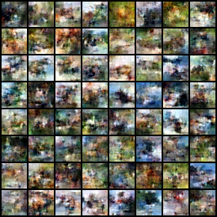

# Control: study/main/cifar10-onn-s101/evaluations/identity

## Purpose and interpretation

This diagnostic checks metric scale/repetition or identity-intervention behavior. It is excluded from primary paired-seed inference and cannot establish an oscillator mechanism by itself.

## Recorded evidence

```json
{
  "identity_exact_equal": true,
  "id": "study/main/cifar10-onn-s101/evaluations/identity",
  "artifact": "runs/study/main/cifar10-onn-s101/evaluations/identity/control.json"
}
```

## Fixed sample grid



## Method choices and learning

The shared optimizer, data policy, architecture, and stopping rule were chosen before final comparison and are described in the technical paper. The 3e-4 learning rate is a conservative AdamW starting point, not a tuned optimum. Microbatches bound laptop memory; four internal updates bound recurrent cost; EMA smooths noisy parameter updates. These choices trade study breadth for a fixed local compute budget. This record supports only the measurements above; causes of quality differences require the trained controls and uncertainty analysis. Full trajectories, populations, RNG states, and logs remain in the referenced artifact bundle. Sources: [protocol](https://github.com/BurnyCoder/flow-matching-with-oscillatory-neural-networks-instead-of-transformer/blob/main/docs/protocol.md), [TorchCFM](https://github.com/atong01/conditional-flow-matching), [AKOrN](https://arxiv.org/html/2410.13821v2).
