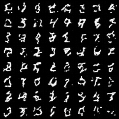

# Control: study/pilot/mnist-onn-s101/cpu-public-check

## Purpose and interpretation

This diagnostic checks metric scale/repetition or identity-intervention behavior. It is excluded from primary paired-seed inference and cannot establish an oscillator mechanism by itself.

## Recorded evidence

```json
{
  "kind": "public-checkpoint-reload",
  "status": "completed",
  "repository": "BurnyCoder/oscillatory-flow-matching-mnist",
  "path": "study/pilot/mnist-onn-s101",
  "checkpoint_sha256": "f11cdc5df1a58a9be3dd5973d540755c240dcb1c67246627de8aaf8229e0b7e6",
  "public_weights_sha256": "06201135c2255dcc8b2ee988f9ce128ce6fe2e6eb35f3fd142b3a4db415fec96",
  "prediction_max_absolute_difference": 0.0,
  "device": "cpu",
  "seed": 20261016,
  "sample_count": 64,
  "nfe": 32,
  "id": "study/pilot/mnist-onn-s101/cpu-public-check",
  "artifact": "runs/study/pilot/mnist-onn-s101/cpu-public-check/control.json"
}
```

## Fixed sample grid



## Method choices and learning

The shared optimizer, data policy, architecture, and stopping rule were chosen before final comparison and are described in the technical paper. The 3e-4 learning rate is a conservative AdamW starting point, not a tuned optimum. Microbatches bound laptop memory; four internal updates bound recurrent cost; EMA smooths noisy parameter updates. These choices trade study breadth for a fixed local compute budget. This record supports only the measurements above; causes of quality differences require the trained controls and uncertainty analysis. Full trajectories, populations, RNG states, and logs remain in the referenced artifact bundle. Sources: [protocol](../../docs/protocol.md), [TorchCFM](https://github.com/atong01/conditional-flow-matching), [AKOrN](https://arxiv.org/html/2410.13821v2).
