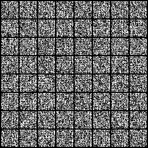

# Evaluation: checks/mnist-smoke/validation-check

## Purpose and interpretation

This evaluation measures a fixed checkpoint and fixed noise population. KID subset SD describes metric subsampling variability; it is not a confidence interval across trained seeds. The first 64 images are shown without selection.

## Recorded evidence

```json
{
  "dataset": "mnist",
  "family": "onn",
  "training_seed": 101,
  "split": "validation",
  "intervention": "none",
  "generated_count": 128,
  "real_count": 5000,
  "sampling_seed": 20261016,
  "metric_seed": 20261016,
  "nfe": 32,
  "kid_subsets": 100,
  "kid_subset_size": 128,
  "checkpoint_sha256": "8f38d4c79f09a651583cc67b6596ab438a75269ad8fcb6a89db4135257a2a9db",
  "data_sha256": "39da09b6ccbbfae8c6424de59b611882eba7f0fb590999ef1851e80f2d027b1c",
  "source_revision": "5b69c903ddac223b5d44e6967dcd49ebd4e136cc",
  "primary_eligible": false,
  "device": "cuda",
  "status": "completed",
  "sampling": {
    "count": 128,
    "seed": 20261016,
    "nfe": 32,
    "batch_size": 32,
    "seconds": 2.681424114998663,
    "seconds_per_image": 0.020948625898427053,
    "precision": "float32",
    "timing_excludes": "model load and warmup",
    "clipped_fraction": 0.3916613459587097,
    "peak_memory_bytes": 55247872
  },
  "metrics": {
    "pixel_sliced_wasserstein": 1.1010091948096694,
    "projections": 128
  },
  "validation_velocity_mse": 2.0086912736296654,
  "metric_seconds": 0.24426259099709569,
  "id": "checks/mnist-smoke/validation-check",
  "artifact": "runs/checks/mnist-smoke/validation-check/evaluation.json"
}
```

## Fixed sample grid



## Method choices and learning

The shared optimizer, data policy, architecture, and stopping rule were chosen before final comparison and are described in the technical paper. The 3e-4 learning rate is a conservative AdamW starting point, not a tuned optimum. Microbatches bound laptop memory; four internal updates bound recurrent cost; EMA smooths noisy parameter updates. These choices trade study breadth for a fixed local compute budget. This record supports only the measurements above; causes of quality differences require the trained controls and uncertainty analysis. Full trajectories, populations, RNG states, and logs remain in the referenced artifact bundle. Sources: [protocol](../../docs/protocol.md), [TorchCFM](https://github.com/atong01/conditional-flow-matching), [AKOrN](https://arxiv.org/html/2410.13821v2).
