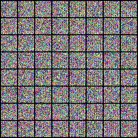

# Evaluation: study/controls/untrained-dit/evaluations/test

## Purpose and interpretation

This evaluation measures a fixed checkpoint and fixed noise population. KID subset SD describes metric subsampling variability; it is not a confidence interval across trained seeds. The first 64 images are shown without selection.

## Recorded evidence

```json
{
  "dataset": "cifar10",
  "family": "dit",
  "training_seed": 101,
  "split": "test",
  "intervention": "none",
  "generated_count": 5000,
  "real_count": 10000,
  "sampling_seed": 20261016,
  "metric_seed": 20261016,
  "nfe": 32,
  "kid_subsets": 100,
  "kid_subset_size": 1000,
  "checkpoint_sha256": "f88d4f36bb900a4e46ba2852061a0c8c8d1dcb0f465a8def494aee59c03793ca",
  "data_sha256": "51ca348f81e4c280d10942cf2fa0d4dd1ce688a16b0088283069b54bbaaf6f97",
  "source_revision": "b49e52bb12834bd0f151a4f45a36462182130a8d",
  "primary_eligible": false,
  "device": "cuda",
  "blas_threads": 4,
  "status": "completed",
  "sampling": {
    "count": 5000,
    "seed": 20261016,
    "nfe": 32,
    "batch_size": 32,
    "seconds": 54.84997584299708,
    "seconds_per_image": 0.010969995168599417,
    "precision": "float32",
    "timing_excludes": "model load and warmup",
    "clipped_fraction": 0.3889302611351013,
    "peak_memory_bytes": 58955776
  },
  "metrics": {
    "frechet_inception_distance": 455.44189630425217,
    "kernel_inception_distance_mean": 0.601732451915741,
    "kernel_inception_distance_std": 0.002813938709022414
  },
  "validation_velocity_mse": 1.6222492009401321,
  "metric_seconds": 20.601265713994508,
  "id": "study/controls/untrained-dit/evaluations/test",
  "artifact": "runs/study/controls/untrained-dit/evaluations/test/evaluation.json"
}
```

## Fixed sample grid



## Method choices and learning

The shared optimizer, data policy, architecture, and stopping rule were chosen before final comparison and are described in the technical paper. The 3e-4 learning rate is a conservative AdamW starting point, not a tuned optimum. Microbatches bound laptop memory; four internal updates bound recurrent cost; EMA smooths noisy parameter updates. These choices trade study breadth for a fixed local compute budget. This record supports only the measurements above; causes of quality differences require the trained controls and uncertainty analysis. Full trajectories, populations, RNG states, and logs remain in the referenced artifact bundle. Sources: [protocol](https://github.com/BurnyCoder/flow-matching-with-oscillatory-neural-networks-instead-of-transformer/blob/main/docs/protocol.md), [TorchCFM](https://github.com/atong01/conditional-flow-matching), [AKOrN](https://arxiv.org/html/2410.13821v2).
