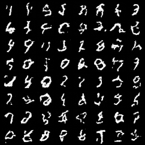

# Evaluation: study/pilot/mnist-conv-s101/evaluations/validation

## Purpose and interpretation

This evaluation measures a fixed checkpoint and fixed noise population. KID subset SD describes metric subsampling variability; it is not a confidence interval across trained seeds. The first 64 images are shown without selection.

## Recorded evidence

```json
{
  "dataset": "mnist",
  "family": "conv",
  "training_seed": 101,
  "split": "validation",
  "intervention": "none",
  "generated_count": 512,
  "real_count": 5000,
  "sampling_seed": 20261016,
  "metric_seed": 20261016,
  "nfe": 32,
  "kid_subsets": 100,
  "kid_subset_size": 512,
  "checkpoint_sha256": "3fffc15466b2561ab3b0ebe9ad66272c4c4e3fe99e0f13602910d1f7da80b651",
  "data_sha256": "39da09b6ccbbfae8c6424de59b611882eba7f0fb590999ef1851e80f2d027b1c",
  "source_revision": "7926ff79c12be5d85eadb49b81aad5d3acfaedcd",
  "primary_eligible": false,
  "device": "cuda",
  "blas_threads": 4,
  "status": "completed",
  "sampling": {
    "count": 512,
    "seed": 20261016,
    "nfe": 32,
    "batch_size": 32,
    "seconds": 6.828010666999035,
    "seconds_per_image": 0.01333595833398249,
    "precision": "float32",
    "timing_excludes": "model load and warmup",
    "clipped_fraction": 0.31511828303337097,
    "peak_memory_bytes": 54438912
  },
  "metrics": {
    "pixel_sliced_wasserstein": 0.0634409949580177,
    "projections": 128
  },
  "validation_velocity_mse": 0.21519694197922945,
  "metric_seconds": 0.3047300489997724,
  "id": "study/pilot/mnist-conv-s101/evaluations/validation",
  "artifact": "runs/study/pilot/mnist-conv-s101/evaluations/validation/evaluation.json"
}
```

## Fixed sample grid



## Method choices and learning

The shared optimizer, data policy, architecture, and stopping rule were chosen before final comparison and are described in the technical paper. The 3e-4 learning rate is a conservative AdamW starting point, not a tuned optimum. Microbatches bound laptop memory; four internal updates bound recurrent cost; EMA smooths noisy parameter updates. These choices trade study breadth for a fixed local compute budget. This record supports only the measurements above; causes of quality differences require the trained controls and uncertainty analysis. Full trajectories, populations, RNG states, and logs remain in the referenced artifact bundle. Sources: [protocol](../../docs/protocol.md), [TorchCFM](https://github.com/atong01/conditional-flow-matching), [AKOrN](https://arxiv.org/html/2410.13821v2).
