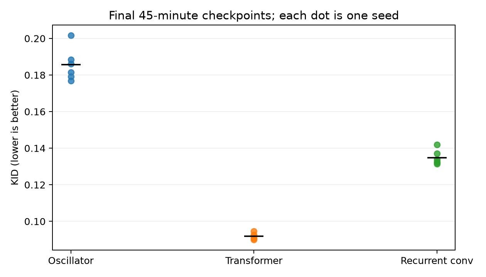
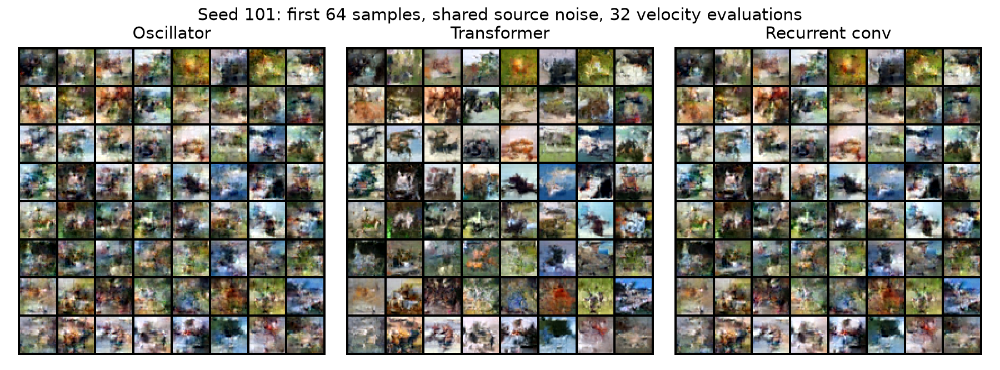
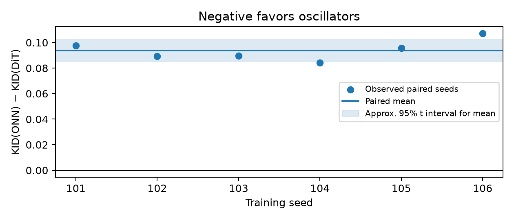
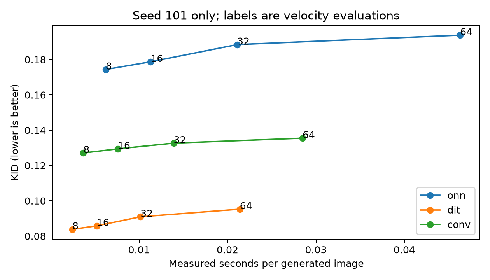

# Oscillatory velocity networks for budget-constrained image flow matching

**Libor Burian**, independent researcher

## Abstract

We implement an attention-free, AKOrN-inspired velocity network for unconditional image generation and a reproducible comparison with a small DiT-style transformer and recurrent convolutional control. The design isolates backbone computation while sharing a straight conditional flow-matching path, data preparation, optimizer, and numerical sampler. The planned primary comparison uses six paired CIFAR-10 seeds, 45 minutes per model, 5,000 generated images per seed, and 32 velocity evaluations. The mean oscillator-minus-transformer KID difference is 0.0938838 (approximate 95% t interval [0.085429, 0.102339]; exact two-sided sign-flip p = 0.03125). **The observed positive KID difference contradicts the proposed oscillator improvement in this regime.** At report generation, 30 training/control records and 43 completed evaluations were available. The [recorded analysis](analysis.json) and linked experiment tables below provide the empirical evidence. This is an exploratory local-compute study, not a claim of state-of-the-art performance.

## Context, motivation, and introduction

Flow matching specifies a regression target for a continuous generative transport; it does not require self-attention. This experiment asks whether a coupled-oscillator parameterization gives useful sample quality for its measured cost on a small laptop GPU. The proposed advantage is falsifiable: an oscillator-minus-transformer KID difference reliably above zero contradicts improvement in this regime. A wide interval spanning zero is inconclusive. Implementation feasibility and comparative quality are separate claims.

## Background and related work

[Flow Matching for Generative Modeling](https://arxiv.org/abs/2210.02747) motivates velocity regression along conditional probability paths. [TorchCFM](https://github.com/atong01/conditional-flow-matching) supplies the independent linear conditional path used here. [Artificial Kuramoto Oscillatory Neurons](https://arxiv.org/html/2410.13821v2), equations 4–7, motivates vector-valued spherical dynamics and linear mixing before a norm readout. This is an independent adaptation of those published equations to an image-velocity network, not copied AKOrN repository code or a reproduction of its original experiments. [Scalable Diffusion Models with Transformers](https://arxiv.org/abs/2212.09748) motivates the time-conditioned transformer control. [Kuramoto Orientation Diffusion Models](https://arxiv.org/abs/2509.15328) is related work on a different generative process; this study changes the velocity backbone while retaining the ordinary image-space transport. We make no first-in-literature claim. KID follows the kernel-based estimator described in [Demystifying MMD GANs](https://arxiv.org/abs/1801.01401), implemented with [torch-fidelity](https://torch-fidelity.readthedocs.io/en/latest/).

## Method

### Domain, data, and leakage control

MNIST (28×28, one channel) is the pilot domain; CIFAR-10 (32×32, RGB) is the comparison domain. Official torchvision training/test sources are downloaded with their supported archive integrity checks. A fixed stratified 5,000-example validation reservation uses split seed 20261016. SHA-256 hashes of decoded image bytes identify exact overlap; validation images overlapping test are excluded, and training examples overlapping either reserved validation or test are removed before manifests are frozen. This audit detects exact duplicates, not near-duplicates or feature-extractor pretraining contamination. Every model uses the same surviving indices, native pixel resolution, and uint8/127.5−1 normalization. There is no augmentation, label conditioning, pretrained generator, or curriculum. Test images never enter the optimizer; final metric results do not select hyperparameters or checkpoints.

### Objective and transport

For independent Gaussian noise $x_0$, an image $x_1$, and uniform $t$ on $[0,1]$, train

$$x_t=(1-t)x_0+t x_1,\qquad \mathcal{L}=\mathbb{E}\|v_\theta(x_t,t)-(x_1-x_0)\|_2^2.$$

The implementation uses a mean over pixels and minibatch elements. TorchCFM with sigma zero computes the path mean and conditional velocity; explicit generators supply noise and time so architecture initialization cannot consume these streams. Generation integrates $dx/dt=v_\theta(x,t)$ from Gaussian noise at zero to an image at one, using torchdiffeq's fixed midpoint solver. Sixteen outer steps require 32 actual velocity calls. Oscillator updates occur inside each call and never advance the outer flow time. The contract is `forward(images, times) -> velocities` with identical image shape and an unbounded velocity output.

### Oscillator backbone

A learned stride-four patch convolution maps pixels to width 128, with fixed two-dimensional sinusoidal positions. Continuous sinusoidal flow-time features feed a two-layer SiLU time encoder. Four blocks each evolve 32 four-dimensional hidden vectors per patch for four internal Euler updates of fixed size 0.1. A learned initial embedding is normalized and expanded deterministically on every forward call; no state is carried between ODE evaluations. Within a block, let $s_i$ be a unit vector, $c_i$ a time-conditioned stimulus, $J$ a learned 3×3 convolution, and $\Omega_i=(A_i-A_i^T)/2$ a learned skew-symmetric frequency matrix. Each internal update is

$$d_i=\Omega_i s_i + (J s+c)_i - s_i\langle s_i,(J s+c)_i\rangle,\qquad s_i\leftarrow \frac{s_i+0.1d_i}{\|s_i+0.1d_i\|_2}.$$

State normalization uses epsilon $10^{-8}$. The conditioning stimulus uses per-image GroupNorm and a learned time-dependent affine transformation. Natural frequencies are unconstrained parameters projected to skew symmetry at each use; no symmetry assumption is imposed on the learned convolution, so no energy-minimization guarantee is claimed. States carry between the four blocks within a call. A 1×1 convolution mixes all state channels into 128 four-dimensional vectors; their stabilized norms become 128 features. Mixing before norms is essential because the individual normalized state norms would otherwise be constant. A GroupNorm and two-layer SiLU convolutional readout add a residual scaled by 0.1. A shared LayerNorm/linear patch head reconstructs dense pixel velocities. Geometry and reductions remain float32 during mixed-precision training.

### Baselines, ablations, and sensitivity interventions

The transformer shares patch encoding, positional features, time encoding, and output prediction. Four blocks use four-head self-attention, a GELU MLP, and AdaLN-Zero time-conditioned residual gates. Its feed-forward width is deterministically adjusted in multiples of eight to match the oscillator trainable count within 5%; the default RGB width resolves to 576. The recurrent convolutional control retains the oscillator scaffold, convolution, iteration count, and mixed-state readout, replacing tangent dynamics with GroupNorm of a SiLU residual update. Counts, throughput, and memory are measured rather than assumed equal.

Separate no-coupling and no-natural-frequency models are trained for seeds 101 and 102. Retained parameters start from the corresponding ONN initialization. Removing coupling changes both parameter count and spatial information exchange, so its effects are not an isolated capacity-matched causal estimate; image-wide GroupNorm statistics remain. Zero frequency removes natural rotation, not all dynamics. Inference sensitivity diagnostics permute spatial hidden states after block one while preserving each vector's norm, and compare with an identity intervention on the same checkpoints and source noise. Residual image features are retained. They test sensitivity to correspondence, not whether synchronization caused quality. Untrained architectures and disjoint real-versus-real image populations provide additional controls. The spatial permutation uses seed 20261016 and is fixed before evaluation; it is not selected to maximize degradation. These operations are specified in the [backbone implementation](https://github.com/BurnyCoder/flow-matching-with-oscillatory-neural-networks-instead-of-transformer/blob/main/src/ofm/models/backbone.py) and [oscillator blocks](https://github.com/BurnyCoder/flow-matching-with-oscillatory-neural-networks-instead-of-transformer/blob/main/src/ofm/models/oscillator.py).

### Optimization, pairing, and budget

All trainable generators start from scratch with AdamW, learning rate 0.0003, betas (0.9,0.999), weight decay 0.01, effective batch 128, microbatch 32, gradient clipping at 1.0, and EMA decay 0.999. The initial rate is a conservative Adam starting point, not a validated optimum. Accumulation weights each microbatch by its fraction of the effective batch. BF16 autocast is used on CUDA while the MSE and oscillator geometry remain float32. Sampling and held-out velocity diagnostics use float32. CPU sampling is supported. No learning-rate search or adaptive quality-based stopping is used.

Seed-derived streams separate model initialization, data ordering, flow targets, validation, and generation. Data/noise/time stream prefixes are paired across architectures, while model initialization streams are independent. Unequal throughput implies different numbers of updates and examples at equal wall time; this is part of the quality-versus-cost estimand. Model execution order is randomized within each seed group before training. Checkpoints save optimizer, EMA, data permutation/cursor, CPU/CUDA RNG states, elapsed training time, dataset hash, resolved configuration, and source history. The final budget checkpoint is evaluated, not the best intermediate checkpoint.

The allocation is at most 1.5 GPU-hours for checks/pilot, 13.5 training hours for three CIFAR architectures × six seeds, three training hours for two ablations × two seeds, and six hours for sampling/evaluation/contingency. A shared file-locked ledger reserves time before GPU allocation, refunds unused reservations only on orderly exit, and charges crashed reservations conservatively. Cooperative loop checks leave cleanup time; an independent process deadline terminates a blocked worker near reservation expiry. The total ceiling is 24 occupied GPU-hours across resumes. Initialization, validation, checkpoints, downloads within reservations, and stalled wall time are conservatively charged; training-overhead accounting can therefore exceed the nominal optimizer-time allocation and consumes contingency. We do not measure energy, GPU utilization integrals, or hardware-independent FLOPs. The local target is an RTX 5070 Laptop GPU with 8 GB VRAM; actual software/hardware records accompany every run.

### Measurement and pre-specified analysis

The primary outcome is unscaled KID between 5,000 generated CIFAR images and all 10,000 official test images, with 100 subsets of size 1,000 and identical torch-fidelity Inception preprocessing and metric RNG. Generation and metric seed 20261016 is fixed across arms and training seeds. Generated floats are clamped to [-1,1], mapped to [0,255], rounded, and converted to uint8; complete unclipped tensors and clipping fractions remain available. Real images retain their original uint8 values. torch-fidelity owns resizing and feature normalization for both populations. Negative unbiased KID estimates are retained. FID is secondary and its generated/real sample counts accompany every value. MNIST uses 128-projection pixel-space sliced Wasserstein distance only as a pilot diagnostic; it is not mislabeled as semantic image quality. Velocity MSE uses the first fixed 512 surviving validation indices with a separate, training-seed-derived supervision stream, paired across architectures. Native BLAS metric threads are bounded by the recorded CPU-thread setting (default four).

For six primary seed pairs, report each KID difference, its mean, an approximate two-sided 95% Student-t interval with five degrees of freedom, and an exact two-sided paired sign-flip p-value at alpha 0.05. The t interval assumes approximately normal independent seed differences; sign-flip inference requires sign exchangeability/symmetry under the null. Six seeds cannot establish these assumptions. KID subset SD concerns one fixed image population and is not a standard error across trained models. Intervals condition on the fixed data split, test population, generation noise, metric RNG, and hardware. The shared dataset/evaluator limits external generalization. If any declared primary pair is missing, report available observations and incompleteness without complete-study inference. Ablations, fixed-seed cost curves, and interventions are descriptive secondary analyses without multiplicity-adjusted confirmatory claims.

The pre-training power calculation used 20,000 simulated Gaussian six-difference samples, all 64 sign assignments, and seed 20261016. At standardized effect 0.8, simulated rejection probability was 0.2406 (Monte Carlo standard error 0.0030). The first study is therefore exploratory and underpowered for moderate effects. Neither sample count nor training duration is extended to obtain significance. Measured throughput, synchronized generation latency, peak allocated GPU memory, parameter counts, and validation velocity MSE supplement distribution metrics. The seed-101 quality-cost curve uses 8,16,32,64 evaluations; no best seed is selected.

## Results and claims

The observed positive KID difference contradicts the proposed oscillator improvement in this regime.

The mean oscillator-minus-transformer KID difference is 0.0938838 (approximate 95% t interval [0.085429, 0.102339]; exact two-sided sign-flip p = 0.03125).

### Fixed-budget comparison

| Model | Parameters | Mean KID | Mean FID | Train images/s | Sample ms/image | Peak train/sample MiB |
| --- | --- | --- | --- | --- | --- | --- |
| onn | 1297712 | 0.185673 | 175.085 | 396.893 | 23.4015 | 228.213/57.9087 |
| dit | 1298864 | 0.0917895 | 104.646 | 787.423 | 10.9095 | 153.589/56.2246 |
| conv | 1296688 | 0.134872 | 134.063 | 580.914 | 15.7993 | 186.178/57.1528 |

Each available row summarizes all six declared seeds at 45 training minutes and 32 velocity evaluations. KID, FID, throughput, and latency are arithmetic means across seeds. Each quality evaluation uses 5,000 generated and 10,000 real images. Memory is the maximum allocated peak across those six runs, in MiB; it excludes the CUDA context and other processes. The [training](#training-and-capacity) and [evaluation](#quality-and-sampling-cost) tables link every underlying observation. Seed uncertainty belongs to the paired analysis below, not to KID subset SD.

Relative to the transformer, the oscillator achieved 0.504041 times the mean training throughput and required 2.14506 times the mean sampling time per image. These are ratios of the six-seed arithmetic means in the table, measured on this runtime; they are not hardware-independent operation counts.

Primary paired analysis:

```text
{
  "n_pairs": 6,
  "differences": [
    0.09758904933929442,
    0.08926941156387329,
    0.08946457147598266,
    0.0842514681816101,
    0.09565028429031372,
    0.10707796096801758
  ],
  "mean_difference": 0.09388379096984863,
  "ci95": [
    0.08542897054008555,
    0.1023386113996117
  ],
  "p_value": 0.03125
}
```

### Training and capacity

| Run | Status | Parameters | Updates | Train seconds | Images/s | Validation MSE |
| --- | --- | --- | --- | --- | --- | --- |
| [checks/cifar10-metric-smoke](<experiments/training-checks--cifar10-metric-smoke.md>) | untrained | 1297712 | 0 | 0 | — | — |
| [checks/mnist-smoke](<experiments/training-checks--mnist-smoke.md>) | step_limit | 1289488 | 100 | 33.9622 | 376.889 | 2.00869 |
| [study/ablations/cifar10-no_coupling-s101](<experiments/training-study--ablations--cifar10-no_coupling-s101.md>) | completed | 707888 | 9405 | 2700.28 | 445.82 | 0.262754 |
| [study/ablations/cifar10-no_coupling-s102](<experiments/training-study--ablations--cifar10-no_coupling-s102.md>) | completed | 707888 | 10045 | 2700.04 | 476.2 | 0.266352 |
| [study/ablations/cifar10-no_frequency-s101](<experiments/training-study--ablations--cifar10-no_frequency-s101.md>) | completed | 1295664 | 10320 | 2700.08 | 489.23 | 0.211623 |
| [study/ablations/cifar10-no_frequency-s102](<experiments/training-study--ablations--cifar10-no_frequency-s102.md>) | completed | 1295664 | 10583 | 2700.13 | 501.688 | 0.216272 |
| [study/controls/untrained-conv](<experiments/training-study--controls--untrained-conv.md>) | untrained | 1296688 | 0 | 0 | — | — |
| [study/controls/untrained-dit](<experiments/training-study--controls--untrained-dit.md>) | untrained | 1298864 | 0 | 0 | — | — |
| [study/controls/untrained-onn](<experiments/training-study--controls--untrained-onn.md>) | untrained | 1297712 | 0 | 0 | — | — |
| [study/main/cifar10-conv-s101](<experiments/training-study--main--cifar10-conv-s101.md>) | completed | 1296688 | 12473 | 2700.18 | 591.272 | 0.203593 |
| [study/main/cifar10-conv-s102](<experiments/training-study--main--cifar10-conv-s102.md>) | completed | 1296688 | 12365 | 2700.18 | 586.153 | 0.210089 |
| [study/main/cifar10-conv-s103](<experiments/training-study--main--cifar10-conv-s103.md>) | completed | 1296688 | 12482 | 2700.07 | 591.725 | 0.212733 |
| [study/main/cifar10-conv-s104](<experiments/training-study--main--cifar10-conv-s104.md>) | completed | 1296688 | 12480 | 2700.04 | 591.637 | 0.210087 |
| [study/main/cifar10-conv-s105](<experiments/training-study--main--cifar10-conv-s105.md>) | completed | 1296688 | 12236 | 2700.17 | 580.04 | 0.213325 |
| [study/main/cifar10-conv-s106](<experiments/training-study--main--cifar10-conv-s106.md>) | completed | 1296688 | 11489 | 2700.03 | 544.658 | 0.221481 |
| [study/main/cifar10-dit-s101](<experiments/training-study--main--cifar10-dit-s101.md>) | completed | 1298864 | 16959 | 2700.17 | 803.93 | 0.192738 |
| [study/main/cifar10-dit-s102](<experiments/training-study--main--cifar10-dit-s102.md>) | completed | 1298864 | 17303 | 2700.06 | 820.271 | 0.197029 |
| [study/main/cifar10-dit-s103](<experiments/training-study--main--cifar10-dit-s103.md>) | completed | 1298864 | 17148 | 2700.12 | 812.907 | 0.201229 |
| [study/main/cifar10-dit-s104](<experiments/training-study--main--cifar10-dit-s104.md>) | completed | 1298864 | 16981 | 2700.03 | 805.017 | 0.198842 |
| [study/main/cifar10-dit-s105](<experiments/training-study--main--cifar10-dit-s105.md>) | completed | 1298864 | 15926 | 2700.13 | 754.973 | 0.201822 |
| [study/main/cifar10-dit-s106](<experiments/training-study--main--cifar10-dit-s106.md>) | completed | 1298864 | 15345 | 2700.11 | 727.438 | 0.208719 |
| [study/main/cifar10-onn-s101](<experiments/training-study--main--cifar10-onn-s101.md>) | completed | 1297712 | 8589 | 2700.05 | 407.175 | 0.215884 |
| [study/main/cifar10-onn-s102](<experiments/training-study--main--cifar10-onn-s102.md>) | completed | 1297712 | 8588 | 2700.09 | 407.122 | 0.220631 |
| [study/main/cifar10-onn-s103](<experiments/training-study--main--cifar10-onn-s103.md>) | completed | 1297712 | 8632 | 2700.27 | 409.179 | 0.224278 |
| [study/main/cifar10-onn-s104](<experiments/training-study--main--cifar10-onn-s104.md>) | completed | 1297712 | 8536 | 2700.11 | 404.654 | 0.221115 |
| [study/main/cifar10-onn-s105](<experiments/training-study--main--cifar10-onn-s105.md>) | completed | 1297712 | 8248 | 2700.25 | 390.981 | 0.226086 |
| [study/main/cifar10-onn-s106](<experiments/training-study--main--cifar10-onn-s106.md>) | completed | 1297712 | 7642 | 2700.3 | 362.248 | 0.234817 |
| [study/pilot/mnist-conv-s101](<experiments/training-study--pilot--mnist-conv-s101.md>) | completed | 1288464 | 5245 | 1200.05 | 559.445 | 0.215197 |
| [study/pilot/mnist-dit-s101](<experiments/training-study--pilot--mnist-dit-s101.md>) | completed | 1290640 | 6778 | 1200.04 | 722.965 | 0.203531 |
| [study/pilot/mnist-onn-s101](<experiments/training-study--pilot--mnist-onn-s101.md>) | completed | 1289488 | 3736 | 1200.25 | 398.425 | 0.231511 |

### Quality and sampling cost

| Evaluation | Generated/real N | NFE | KID mean | KID subset SD | FID | Pixel SWD | ms/image |
| --- | --- | --- | --- | --- | --- | --- | --- |
| [checks/cifar10-metric-smoke/evaluations/validation](<experiments/evaluation-checks--cifar10-metric-smoke--evaluations--validation.md>) | 128/5000 | 32 | 0.609741 | 0.0059603 | 487.666 | — | 21.3627 |
| [checks/mnist-smoke/validation-check](<experiments/evaluation-checks--mnist-smoke--validation-check.md>) | 128/5000 | 32 | — | — | — | 1.10101 | 20.9486 |
| [study/ablations/cifar10-no_coupling-s101/evaluations/test-nfe32](<experiments/evaluation-study--ablations--cifar10-no_coupling-s101--evaluations--test-nfe32.md>) | 5000/10000 | 32 | 0.26963 | 0.00267395 | 269.031 | — | 19.4271 |
| [study/ablations/cifar10-no_coupling-s102/evaluations/test-nfe32](<experiments/evaluation-study--ablations--cifar10-no_coupling-s102--evaluations--test-nfe32.md>) | 5000/10000 | 32 | 0.267981 | 0.00290885 | 266.878 | — | 22.0612 |
| [study/ablations/cifar10-no_frequency-s101/evaluations/test-nfe32](<experiments/evaluation-study--ablations--cifar10-no_frequency-s101--evaluations--test-nfe32.md>) | 5000/10000 | 32 | 0.169792 | 0.0025135 | 163.113 | — | 16.5046 |
| [study/ablations/cifar10-no_frequency-s102/evaluations/test-nfe32](<experiments/evaluation-study--ablations--cifar10-no_frequency-s102--evaluations--test-nfe32.md>) | 5000/10000 | 32 | 0.160263 | 0.0024495 | 156.719 | — | 16.0385 |
| [study/controls/untrained-conv/evaluations/test](<experiments/evaluation-study--controls--untrained-conv--evaluations--test.md>) | 5000/10000 | 32 | 0.604058 | 0.00279767 | 456.73 | — | 19.9959 |
| [study/controls/untrained-dit/evaluations/test](<experiments/evaluation-study--controls--untrained-dit--evaluations--test.md>) | 5000/10000 | 32 | 0.601732 | 0.00281394 | 455.442 | — | 10.97 |
| [study/controls/untrained-onn/evaluations/test](<experiments/evaluation-study--controls--untrained-onn--evaluations--test.md>) | 5000/10000 | 32 | 0.599606 | 0.00259296 | 455.38 | — | 28.3087 |
| [study/main/cifar10-conv-s101/evaluations/test-nfe16](<experiments/evaluation-study--main--cifar10-conv-s101--evaluations--test-nfe16.md>) | 5000/10000 | 16 | 0.129412 | 0.0022568 | 127.666 | — | 7.59598 |
| [study/main/cifar10-conv-s101/evaluations/test-nfe32](<experiments/evaluation-study--main--cifar10-conv-s101--evaluations--test-nfe32.md>) | 5000/10000 | 32 | 0.132659 | 0.00224372 | 132.002 | — | 13.9111 |
| [study/main/cifar10-conv-s101/evaluations/test-nfe64](<experiments/evaluation-study--main--cifar10-conv-s101--evaluations--test-nfe64.md>) | 5000/10000 | 64 | 0.135467 | 0.00227747 | 135.195 | — | 28.4834 |
| [study/main/cifar10-conv-s101/evaluations/test-nfe8](<experiments/evaluation-study--main--cifar10-conv-s101--evaluations--test-nfe8.md>) | 5000/10000 | 8 | 0.127097 | 0.00227732 | 122.565 | — | 3.69969 |
| [study/main/cifar10-conv-s102/evaluations/test-nfe32](<experiments/evaluation-study--main--cifar10-conv-s102--evaluations--test-nfe32.md>) | 5000/10000 | 32 | 0.137173 | 0.0022348 | 136.479 | — | 14.257 |
| [study/main/cifar10-conv-s103/evaluations/test-nfe32](<experiments/evaluation-study--main--cifar10-conv-s103--evaluations--test-nfe32.md>) | 5000/10000 | 32 | 0.131977 | 0.00215866 | 130.711 | — | 17.6869 |
| [study/main/cifar10-conv-s104/evaluations/test-nfe32](<experiments/evaluation-study--main--cifar10-conv-s104--evaluations--test-nfe32.md>) | 5000/10000 | 32 | 0.131518 | 0.00212369 | 130.908 | — | 14.792 |
| [study/main/cifar10-conv-s105/evaluations/test-nfe32](<experiments/evaluation-study--main--cifar10-conv-s105--evaluations--test-nfe32.md>) | 5000/10000 | 32 | 0.13401 | 0.00216785 | 133.047 | — | 17.3853 |
| [study/main/cifar10-conv-s106/evaluations/test-nfe32](<experiments/evaluation-study--main--cifar10-conv-s106--evaluations--test-nfe32.md>) | 5000/10000 | 32 | 0.141894 | 0.00228545 | 141.231 | — | 16.7635 |
| [study/main/cifar10-dit-s101/evaluations/test-nfe16](<experiments/evaluation-study--main--cifar10-dit-s101--evaluations--test-nfe16.md>) | 5000/10000 | 16 | 0.0857987 | 0.00165292 | 98.6546 | — | 5.21638 |
| [study/main/cifar10-dit-s101/evaluations/test-nfe32](<experiments/evaluation-study--main--cifar10-dit-s101--evaluations--test-nfe32.md>) | 5000/10000 | 32 | 0.0909215 | 0.00172645 | 104.111 | — | 10.1586 |
| [study/main/cifar10-dit-s101/evaluations/test-nfe64](<experiments/evaluation-study--main--cifar10-dit-s101--evaluations--test-nfe64.md>) | 5000/10000 | 64 | 0.0952455 | 0.00181027 | 108.063 | — | 21.3938 |
| [study/main/cifar10-dit-s101/evaluations/test-nfe8](<experiments/evaluation-study--main--cifar10-dit-s101--evaluations--test-nfe8.md>) | 5000/10000 | 8 | 0.0838022 | 0.00163955 | 95.6179 | — | 2.4516 |
| [study/main/cifar10-dit-s102/evaluations/test-nfe32](<experiments/evaluation-study--main--cifar10-dit-s102--evaluations--test-nfe32.md>) | 5000/10000 | 32 | 0.0899517 | 0.00169648 | 103.125 | — | 9.77963 |
| [study/main/cifar10-dit-s103/evaluations/test-nfe32](<experiments/evaluation-study--main--cifar10-dit-s103--evaluations--test-nfe32.md>) | 5000/10000 | 32 | 0.0920323 | 0.00184124 | 105.047 | — | 10.1741 |
| [study/main/cifar10-dit-s104/evaluations/test-nfe32](<experiments/evaluation-study--main--cifar10-dit-s104--evaluations--test-nfe32.md>) | 5000/10000 | 32 | 0.0926866 | 0.00191923 | 105.141 | — | 13.4588 |
| [study/main/cifar10-dit-s105/evaluations/test-nfe32](<experiments/evaluation-study--main--cifar10-dit-s105--evaluations--test-nfe32.md>) | 5000/10000 | 32 | 0.0905512 | 0.00181148 | 104.204 | — | 12.1196 |
| [study/main/cifar10-dit-s106/evaluations/test-nfe32](<experiments/evaluation-study--main--cifar10-dit-s106--evaluations--test-nfe32.md>) | 5000/10000 | 32 | 0.0945936 | 0.00188419 | 106.249 | — | 9.76628 |
| [study/main/cifar10-onn-s101/evaluations/identity](<experiments/evaluation-study--main--cifar10-onn-s101--evaluations--identity.md>) | 5000/10000 | 32 | 0.188511 | 0.00274027 | 176.705 | — | 23.2444 |
| [study/main/cifar10-onn-s101/evaluations/shuffle](<experiments/evaluation-study--main--cifar10-onn-s101--evaluations--shuffle.md>) | 5000/10000 | 32 | 0.263509 | 0.00299769 | 240.955 | — | 23.6636 |
| [study/main/cifar10-onn-s101/evaluations/test-nfe16](<experiments/evaluation-study--main--cifar10-onn-s101--evaluations--test-nfe16.md>) | 5000/10000 | 16 | 0.178735 | 0.00259012 | 168.147 | — | 11.3092 |
| [study/main/cifar10-onn-s101/evaluations/test-nfe32](<experiments/evaluation-study--main--cifar10-onn-s101--evaluations--test-nfe32.md>) | 5000/10000 | 32 | 0.188511 | 0.00274027 | 176.705 | — | 21.099 |
| [study/main/cifar10-onn-s101/evaluations/test-nfe64](<experiments/evaluation-study--main--cifar10-onn-s101--evaluations--test-nfe64.md>) | 5000/10000 | 64 | 0.19384 | 0.00281791 | 181.258 | — | 46.2968 |
| [study/main/cifar10-onn-s101/evaluations/test-nfe8](<experiments/evaluation-study--main--cifar10-onn-s101--evaluations--test-nfe8.md>) | 5000/10000 | 8 | 0.174378 | 0.00246556 | 162.823 | — | 6.22954 |
| [study/main/cifar10-onn-s102/evaluations/identity](<experiments/evaluation-study--main--cifar10-onn-s102--evaluations--identity.md>) | 5000/10000 | 32 | 0.179221 | 0.00275456 | 170.893 | — | 26.7271 |
| [study/main/cifar10-onn-s102/evaluations/shuffle](<experiments/evaluation-study--main--cifar10-onn-s102--evaluations--shuffle.md>) | 5000/10000 | 32 | 0.257773 | 0.00364871 | 233.55 | — | 27.1896 |
| [study/main/cifar10-onn-s102/evaluations/test-nfe32](<experiments/evaluation-study--main--cifar10-onn-s102--evaluations--test-nfe32.md>) | 5000/10000 | 32 | 0.179221 | 0.00275456 | 170.893 | — | 21.6993 |
| [study/main/cifar10-onn-s103/evaluations/test-nfe32](<experiments/evaluation-study--main--cifar10-onn-s103--evaluations--test-nfe32.md>) | 5000/10000 | 32 | 0.181497 | 0.00273838 | 171.989 | — | 24.4268 |
| [study/main/cifar10-onn-s104/evaluations/test-nfe32](<experiments/evaluation-study--main--cifar10-onn-s104--evaluations--test-nfe32.md>) | 5000/10000 | 32 | 0.176938 | 0.00259902 | 167.294 | — | 24.6136 |
| [study/main/cifar10-onn-s105/evaluations/test-nfe32](<experiments/evaluation-study--main--cifar10-onn-s105--evaluations--test-nfe32.md>) | 5000/10000 | 32 | 0.186201 | 0.00282784 | 176.039 | — | 27.2132 |
| [study/main/cifar10-onn-s106/evaluations/test-nfe32](<experiments/evaluation-study--main--cifar10-onn-s106--evaluations--test-nfe32.md>) | 5000/10000 | 32 | 0.201672 | 0.0028731 | 187.592 | — | 21.3573 |
| [study/pilot/mnist-conv-s101/evaluations/validation](<experiments/evaluation-study--pilot--mnist-conv-s101--evaluations--validation.md>) | 512/5000 | 32 | — | — | — | 0.063441 | 13.336 |
| [study/pilot/mnist-dit-s101/evaluations/validation](<experiments/evaluation-study--pilot--mnist-dit-s101--evaluations--validation.md>) | 512/5000 | 32 | — | — | — | 0.0617331 | 9.42476 |
| [study/pilot/mnist-onn-s101/evaluations/validation](<experiments/evaluation-study--pilot--mnist-onn-s101--evaluations--validation.md>) | 512/5000 | 32 | — | — | — | 0.0714237 | 27.8529 |

KID subset SD in the table is metric subset variability, not a training-seed confidence interval. FID is reported only with its finite generated/real population sizes. A missing entry denotes an unmeasured quantity. Status `untrained` is an explicit control and `step_limit` is a development run; neither qualifies as a final 45-minute checkpoint.

### Descriptive trained ablations and inference sensitivity

| Condition | Mean KID | Delta seed 101 | Delta seed 102 | Mean delta |
| --- | --- | --- | --- | --- |
| no_coupling | 0.268806 | 0.0811193 | 0.0887603 | 0.0849398 |
| no_frequency | 0.165027 | -0.018719 | -0.0189579 | -0.0188385 |
| identity | 0.183866 | 0 | 0 | 0 |
| shuffle | 0.260641 | 0.0749986 | 0.0785517 | 0.0767752 |

Each displayed row contains both declared seeds, 101 and 102, at 32 velocity evaluations with 5,000 generated and 10,000 real images. Delta means condition KID minus the corresponding original oscillator KID; positive values indicate degradation. The full [quality table](#quality-and-sampling-cost) links every observation. These two-seed contrasts carry no confirmatory p-value or confidence interval. Removing a trained term changes optimization cost and may change capacity; spatial shuffling instead perturbs an already trained state while retaining residual features. Neither design by itself identifies synchronization as the cause of a quality difference. Identity output equality is checked independently across the complete generated tensors below.









### Numerical checks and controls

| Check | Initial MSE | Final MSE | Ratio | Passed |
| --- | --- | --- | --- | --- |
| [study/checks/fixed-batch](<experiments/diagnostic-study--checks--fixed-batch.md>) | 2.25575 | 0.000602648 | 0.000267161 | True |

| Control | Recorded result |
| --- | --- |
| [checks/cifar10-metric-smoke/evaluations/validation/repeat](<experiments/control-checks--cifar10-metric-smoke--evaluations--validation--repeat.md>) | {"repeat_max_absolute_difference": 0.0} |
| [checks/final-export-reloads](<experiments/control-checks--final-export-reloads.md>) | {"compared_checkpoints": 31, "all_state_tensors_equal": true, "prediction_max_absolute_difference": 0.0} |
| [study/controls/real-versus-real](<experiments/control-study--controls--real-versus-real.md>) | {"metrics": {"frechet_inception_distance": 10.272234758028844, "kernel_inception_distance_mean": -2.55584716796875e-05, "kernel_inception_distance_std": 0.00010886578191701542}, "repeat_max_absolute_difference": 0.0} |
| [study/main/cifar10-onn-s101/evaluations/identity](<experiments/control-study--main--cifar10-onn-s101--evaluations--identity.md>) | {"identity_exact_equal": true} |
| [study/main/cifar10-onn-s102/evaluations/identity](<experiments/control-study--main--cifar10-onn-s102--evaluations--identity.md>) | {"identity_exact_equal": true} |
| [study/pilot/mnist-onn-s101/cpu-public-check](<experiments/control-study--pilot--mnist-onn-s101--cpu-public-check.md>) | {"prediction_max_absolute_difference": 0.0} |

### Failures and compute accounting

Recorded failed attempts: 2. Cumulative charged GPU seconds: 67451.7. An active reservation, if present, is charged in advance and is not all completed work. Ledger history distinguishes successful completion, exceptions, and interrupted reservations. Individual reports retain exact errors and provenance; a later repair does not erase earlier attempts.

## Discussion and implications

The experimental unit is a full training seed, and the comparison applies to these implementations under equal occupied training time. Parameter matching does not equalize operations, receptive fields, memory access, optimization trajectories, or initial conditioning. The throughput measurements explain the different numbers of optimizer updates achieved within 45 minutes, but do not isolate why image quality differs. Unequal data exposure, architectural inductive biases, and the wall-time span of the fixed per-update EMA remain possible contributors. An equal-update experiment would answer a different question and was not added after seeing these outcomes. The conclusion constrains this specific design and budget rather than all oscillator networks. A feasible generator can exist even when its comparative quality is worse. Inference corruption can show dependence on a representation while remaining compatible with several explanations of how that representation was learned.

## Limitations

This study uses small native-resolution datasets, unconditional pixel-space generation, one GPU, a small transformer, and six seeds. It does not address text conditioning, large pretrained generators, latent diffusion, or cloud-scale performance. The 24% planning power at moderate standardized effect makes inconclusive results likely. Two-seed trained ablations have weak uncertainty resolution and coupling removal changes capacity. Fixed hyperparameters may suit architectures unequally. Equal wall time depends on this hardware/software and background load; it is not a universal compute-normalized ranking. EMA with a fixed per-update decay also spans different wall-time windows when throughputs differ. Exact-duplicate exclusion does not remove semantic near-duplicates. Inception-based metrics have representation and finite-sample limitations, and MNIST pixel SWD is especially limited as a semantic measure. Deterministic settings support repeatability on this runtime, not guaranteed bitwise equivalence across hardware or library versions. Training interruptions can lose work since the last checkpoint; the budget still charges that occupied time conservatively.

## Conclusion

The observed positive KID difference contradicts the proposed oscillator improvement in this regime. The released interface, full artifacts, and pre-specified paired analysis support independent reproduction and inspection. Stronger claims require stronger completed evidence, not additional unplanned significance searches.

## Appendix A: reproducibility and artifact map

The repository README contains installation and exact CLI examples. `uv.lock` pins dependencies; the local environment uses Python 3.12 and CUDA 12.8 PyTorch wheels for Blackwell compatibility. Each run records environment versions, Git revisions, configuration, dataset manifests, logs, optimizer/EMA/RNG state, metrics, and full generated tensors. Source data and credentials are excluded from Git and model exports. Published safetensors exports load through the same model constructor with strict key checking; optimizer checkpoints use tensor/primitive-only loading. Timestamped command transcripts preserve emitted stdout/stderr, and full tensors remain binary artifacts. There is no runtime LLM service. The experiment ledger provides a lay glossary and all individual experiment records; the source protocol distinguishes pre-specified analyses from later diagnostics.

## Appendix B: methodology safeguards

This design follows the distinction between evidence and speculation emphasized by [Lipton and Steinhardt](https://arxiv.org/abs/1807.03341), data/validation pitfalls summarized by [Lones](https://arxiv.org/abs/2108.02497), and the [NeurIPS paper checklist](https://neurips.cc/public/guides/PaperChecklist). Fixed-batch overfitting follows the debugging practice described in [Karpathy's training recipe](https://karpathy.github.io/2019/04/25/recipe/). These references motivate procedures; they are not empirical evidence that the proposed architecture is better. All comparisons, failures, resource limits, and distributional assumptions must be read alongside the measured results.
